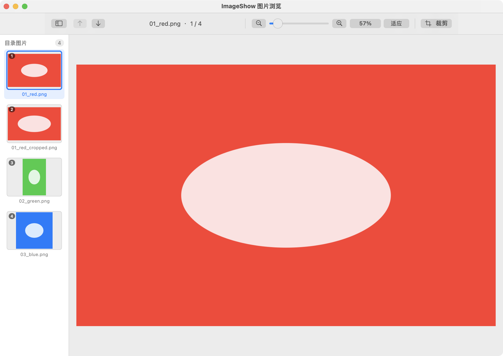
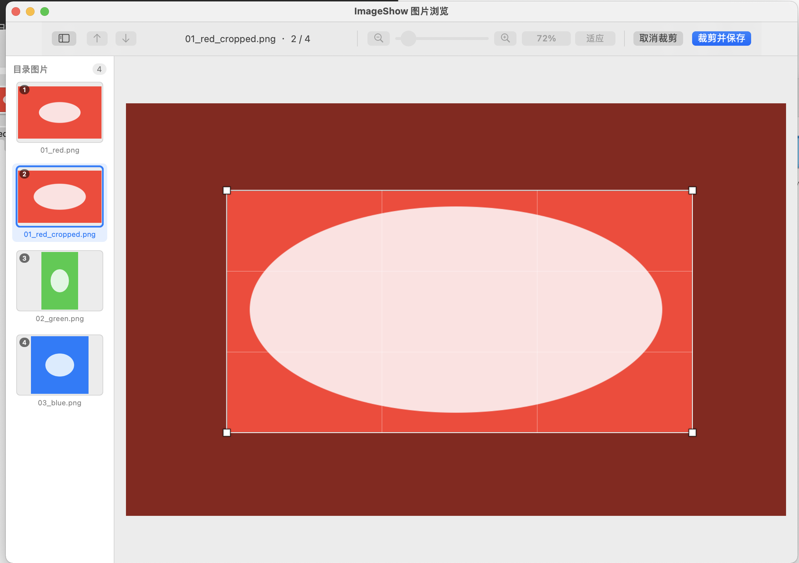

# MacImageShow
Mac电脑上可使用的图片浏览器，支持双击打开图片，并自动扫描同目录的文件，支持鼠标滚轮放大缩小图片，支持上下按键切换图片，左侧有图片缩略图可直接切换图片，一款很好用的macOs平台图片浏览器。

编译：

```
./build.sh
```

#### 编译成功后找一张图片，右键后选择“打开方式”，选择“ImageShow”，或者将“ImageShow”设置为默认打开方式


## 图片展示界面：



## 截图效果：可按住四个角拖动大小
